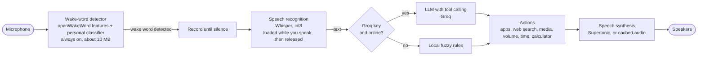

<p align="center">
  
</p>

<h1 align="center">Ruby Assistant</h1>

<p align="center">
  <strong>A private, local-first voice assistant for Windows.</strong><br>
  Wake word trained on your own voice &middot; on-device speech recognition and synthesis &middot; never more than 500&nbsp;MB of RAM
</p>

<p align="center">
  
  
  
  
  
</p>

## Overview

Ruby listens for a wake word trained on **your own voice**, transcribes your request with Whisper, decides what to do (a cloud LLM when you provide a key, local rules otherwise), acts on your PC, and answers out loud with a neural voice running on your machine.

It is built around one hard constraint: **a 500 MB memory budget for the whole application**. At rest Ruby weighs about 10 MB. When you speak, its two large models (speech recognition, then speech synthesis) are loaded one at a time, used, and released.

## Key figures

Measured on Windows 10 LTSC (x64), AMD Ryzen 5 4500 (6 cores / 12 threads), 16 GB RAM. Memory is the *private working set* shown in the Task Manager, sampled every 5 ms over three full runs. Every figure can be reproduced with the scripts in [`tools/`](tools).

| | Metric | Measured |
|---|---|---|
| **Memory** | Engine at rest | **10 MB** |
| | Peak during a command, first command after launch | **473 – 474 MB** |
| | Peak during a command, afterwards | 413 – 453 MB |
| | Settings window at rest | 4 – 15 MB |
| **CPU** | Engine listening for the wake word | 3.3 – 3.6 % of one core (0.3 % of the whole 12-thread CPU) |
| **Speed** | Startup, launch to listening | 2.7 – 2.9 s |
| | Wake-word detector | 2.3 ms per 80 ms audio chunk |
| | Transcription of a 5.4 s command, Whisper small (int8) | 3.7 s (Whisper base: 1.3 s) |
| | Speech synthesis, Supertonic | 2.2 – 3.5x faster than real time, 1.1 s model load |
| | Reply latency, end of speech to first sound | about 3.7 s for a known sentence, 5.5 – 6.4 s for a new one |
| **Footprint** | Installer | 114 MB |
| | Installed application | 431 MB, 1,479 files |
| | Models downloaded on first start | Whisper small 464 MB (+ 245 MB optimized copy), Supertonic voice 385 MB, wake-word features 2.3 MB |
| **Project** | Source code | 3,269 lines of code in 14 Python files |
| | Tests | 10 test files, 1,220 lines, 282 assertions |
| | Release pipeline | tag to published installer in 5.8 min (build 238 s, install/uninstall verification 24 s) |
| **Reach** | Languages | French and English, following the Windows display language |
| | Voices | 10 on-device voices, 7 online voices |
| | Assistant tools | 5 (open app, open browser, web search, media and volume, calculator) |

## Features

- **Personal wake word.** A short enrollment (about one minute) trains a classifier on your voice and your room, on top of [openWakeWord](https://github.com/dscripka/openWakeWord) speech embeddings.
- **On-device speech recognition.** [faster-whisper](https://github.com/SYSTRAN/faster-whisper) with Whisper `base` or `small`, quantized to int8.
- **On-device neural voice.** [Supertonic](https://huggingface.co/Supertone/supertonic-3) with 10 voices; Microsoft Edge online voices are available as an option.
- **Flexible command understanding.** Groq tool calling when an API key is set; offline fuzzy rules otherwise (open applications, web search, volume and media keys, time, calculator).
- **Language follows Windows.** French or English, automatic by default and overridable in the settings.
- **Desktop integration.** Tray icon, screen-edge glow while listening, optional start with Windows.
- **Settings application.** A dark, dedicated window to manage devices, voices, the wake word, models and install locations.

## How it works



### Staying under 500 MB

Whisper small alone peaks at 423 MB while transcribing and the Supertonic voice at about 440 MB, so the two together would exceed 700 MB. Ruby keeps the application under budget by design:

1. **One large model at a time.** Whisper is released as soon as the sentence is transcribed; only then is the voice loaded (while Groq is thinking, when it is used).
2. **Pre-quantized Whisper.** Loading the float16 file with int8 compute peaks at 681 MB. Ruby converts it once to an int8 copy that loads at 265 MB. The conversion reproduces CTranslate2's own quantization exactly (checked against its converter in the test suite, and bit for bit on the model outputs).
3. **A single decoding pass.** Whisper's default temperature fallback runs five sampled decodings and peaks at 850 MB; Ruby decodes once, deterministically.
4. **A disk cache for replies.** A sentence that was already spoken is replayed from disk without loading the voice.
5. **Trimmed working sets.** Unused pages of both processes are handed back to Windows, so the settings window stays in single digits of megabytes.

`tools/measure_budget.py` replays complete cycles with the real models and fails if the peak exceeds the budget.

## Install

1. Download `Ruby-Setup-x.y.z.exe` from the [latest release](../../releases/latest) and run it. No administrator rights are needed; Ruby is installed for the current user.
2. Optionally tick **Start Ruby when I sign in to Windows** (also available later in *General* > *Startup*).
3. Open the settings, go to *Listening* (*Écoute*) and choose *Record my voice* (*Enregistrer ma voix*). Follow the one-minute enrollment; Ruby then downloads its models once (about 850 MB) and starts listening.

The installer is available in English and French, following Windows. It is not code-signed, so Windows SmartScreen may show a warning: choose *More info > Run anyway*. Uninstalling removes the application; your settings and enrolled voice (`%APPDATA%\Ruby`) and the downloaded models are kept.

## Using Ruby

Say your wake word, wait for the short sound, then speak:

> "Hey Ruby, open Discord."
> "Hey Ruby, search for a mushroom pasta recipe."
> "Hey Ruby, what is 12 times 7?"
> "Hey Ruby, pause." / "Volume up."

The wake words are configurable (`hi;hey` by default). When a Groq key is set, any phrasing is understood; without it, Ruby relies on its local rules.

## Settings

| Page | Content |
|---|---|
| Home (*Accueil*) | Live state, loaded components, memory in use, last command |
| General (*Général*) | Wake words, language (automatic or forced), audio devices, volume, screen glow, start with Windows |
| Voice (*Voix*) | Voice engine, voice and speed, preview, install location |
| Listening (*Écoute*) | Voice enrollment, detection threshold with a live meter, Whisper model and install location |
| Intelligence | Groq API key and model |
| Models (*Modèles*) | Every downloaded model: size, location, move or delete |

## Privacy

- Audio is processed on your PC and never uploaded.
- With a Groq key, the **transcribed text** (not the audio) is sent to Groq. Without a key, nothing leaves your PC.
- The Edge voice, if you choose it, sends the sentence to be spoken to Microsoft's service.
- There is no telemetry. Settings, enrolled voice, logs and caches stay on your machine and are excluded from version control. The Groq key is stored in clear text in `config.json`.

## Build from source

Python **3.12** is required (onnxruntime has no build for newer versions).

```bat
py -3.12 -m venv .venv
.venv\Scripts\pip install -r requirements-dev.txt
.venv\Scripts\pythonw ruby.py              :: the engine (tray icon)
.venv\Scripts\pythonw ruby.py --settings   :: the settings window
```

`ruby.py --debug` prints the logs and saves each command to `logs/`; `ruby.py --quit` stops a running Ruby; `ruby.py --selftest` checks that every library and shipped file is present.

**Tests.** Each file prints `OK`; they run in temporary folders and a test registry key, never touching your models or settings.

```bat
for %t in (models wake engine_paths settings sync actions brain audio config entry) do .venv\Scripts\python test_%t.py
```

**Installer.** Needs [Inno Setup 6](https://jrsoftware.org/isdl.php).

```bat
installer\build.ps1 -Version 1.0.0                                  :: PyInstaller, selftest of the bundle, installer
installer\verify.ps1 -Setup installer\Output\Ruby-Setup-1.0.0.exe   :: silent install, selftest, uninstall (in a temp folder)
```

**Release.** Push a tag (`git tag v1.0.0 && git push origin v1.0.0`): GitHub Actions builds the installer, verifies it on a clean Windows runner and publishes it with its SHA-256 checksum.

The application is a folder (`Ruby.exe` + `_internal`) rather than a single file, which would unpack itself into `%TEMP%` on every launch. Installed, it keeps its data in `%APPDATA%\Ruby` (override with the `RUBY_HOME` environment variable).

## Project layout

| Path | Role |
|---|---|
| `ruby.py` | single entry point (engine, `--settings`, `--debug`, `--quit`, `--selftest`) |
| `engine.py` | listening loop, recording, transcription, actions, replies; tray icon and screen glow |
| `settings.py` | settings application (Qt) |
| `wake.py` | personal wake word: feature extractor and classifier |
| `actions.py`, `brain.py` | local rules, Groq tool calling |
| `tts.py`, `audio.py` | speech synthesis with disk cache, sounds and devices |
| `models.py` | model locations, move and delete, int8 conversion of Whisper |
| `config.py`, `memory.py`, `overlay.py` | shared settings (Windows language, autostart), memory measurement, glow |
| `installer/`, `ruby.spec`, `.github/workflows/` | installer script, build and verification, release pipeline |
| `tools/` | real-model memory and end-to-end measurements |

## Known limitations

- The settings interface is currently in French only; the assistant itself (recognition, replies, voice) supports French and English.
- Windows only.
- The installer is not code-signed.
- A sentence Ruby has never spoken takes about 2 seconds longer, because the voice has to be loaded after Whisper has been released. This is the price of the memory budget.

## Acknowledgements

[faster-whisper](https://github.com/SYSTRAN/faster-whisper) and CTranslate2, [Supertonic](https://huggingface.co/Supertone/supertonic-3), [openWakeWord](https://github.com/dscripka/openWakeWord) (Apache-2.0), [Groq](https://groq.com), sound effects by [Kenney](https://kenney.nl) (CC0), [Inno Setup](https://jrsoftware.org/isinfo.php) (used here without a commercial license, for non-commercial use).
